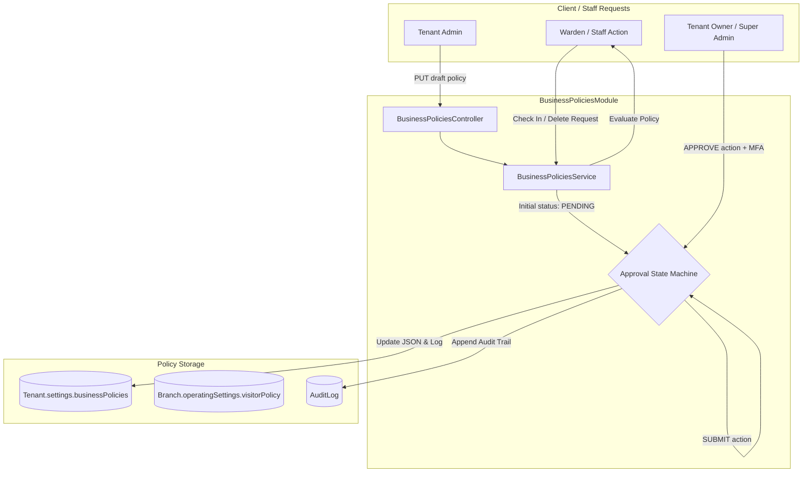

# HMS Business Policies & Configuration Register — Phase 3

## 1. Executive Summary & Governance Principles

This document establishes the technical foundation, configurable settings schema, and approval workflows for the four core business policies of the Hostel Management System (HMS):

1. **Data Retention Policy** (Record & file lifecycle management)
2. **Backup Schedule Policy** (Frequency of automated backups, separated from retention)
3. **Visitor Hours Policy** (Hostel entry/exit rules & emergency override workflows)
4. **Physical Delete Policy** (Guards against unauthorized permanent deletion)

### Core Governance Principles

> [!IMPORTANT]
> **Business Decision Separation:**
> These policies represent **business decisions, not engineering decisions**. The engineering implementation provides safe, configurable foundations and non-destructive defaults. **No arbitrary retention periods, visitor hours, backup schedules, or physical-delete permissions have been selected or activated.**

- **Safe Non-Destructive Defaults:** Automated background purges and physical record deletions are disabled by default (`autoPurgeEnabled: false`, `allowPhysicalDeletion: false`).
- **Owner Sign-Off Requirement:** All policies initialize with status `PENDING_OWNER_APPROVAL`. A policy domain can only transition to `APPROVED` through explicit authorization by an authenticated user holding the `Owner` role or a Platform `Super Admin`.
- **Statutory Financial & Audit Immutability:** In accordance with financial regulations, tax requirements, and non-repudiation standards, invoices, payments, refunds, and audit logs are **permanently locked against physical deletion and premature destruction**.

---

## 2. Policy 1: Data Retention Policy

### A. Entity & File Lifecycle Inventory

The following table categorizes all system records and stored binary files that require lifecycle governance:

| Entity Category | Database Models & Storage Buckets | Sensitivity / Legal Class | Regulatory & Operational Context | Configurable Actions on Expiry |
|---|---|---|---|---|
| **Residents** | `residents` table | PII, Contact, CNIC | Required during residency + post-departure dispute/alumni window | `RETAIN_INDEFINITELY`, `ARCHIVE_SOFT_DELETE`, `ANONYMIZE_PII` |
| **Admissions** | `admissions` table | Applicant PII, Room requests | Rejected/cancelled applications require shorter retention than active admissions | `RETAIN_INDEFINITELY`, `ARCHIVE_SOFT_DELETE` |
| **Financial Records** | `invoices`, `invoice_lines`, `payments`, `refunds`, `security_deposit_transactions` | Financial, Tax, Accounting | **Statutory fiscal requirement:** Minimum 7 years (2555 days) or permanent retention. Invoices/payments are immutable. | `RETAIN_INDEFINITELY` (Locked against purge) |
| **Documents & Files** | `student_documents` table, `private-documents` S3 bucket | Identity scans (CNIC, B-Form) | Linked to resident lifecycle; requires secure storage | `RETAIN_INDEFINITELY`, `ARCHIVE_SOFT_DELETE` |
| **Payment Proofs** | `payments.proof_storage_key`, `private-proofs` S3 bucket | Bank deposit slips, receipts | Linked to payment transaction; supports financial audits | `RETAIN_INDEFINITELY`, `ARCHIVE_SOFT_DELETE` |
| **Visitor Logs** | `visitor_visits` table | Visitor PII, Encrypted CNIC | Security logs; privacy regulations recommend 90-365 days retention | `RETAIN_INDEFINITELY`, `ARCHIVE_SOFT_DELETE`, `ANONYMIZE_PII` |
| **Audit Logs** | `audit_logs`, `platform_admin_audit_logs` | Compliance, Non-repudiation | Append-only system logs; essential for regulatory and security investigations | `RETAIN_INDEFINITELY` (Locked against purge) |

### B. Configurable Settings Schema

Configurable via `PUT /api/v1/business-policies/retention`:

```json
{
  "residents": {
    "retentionDaysAfterDeparture": null,
    "retentionScope": "DEPARTED_ONLY",
    "actionOnExpiry": "RETAIN_INDEFINITELY"
  },
  "admissions": {
    "rejectedRetentionDays": null,
    "cancelledRetentionDays": null,
    "actionOnExpiry": "RETAIN_INDEFINITELY"
  },
  "financialRecords": {
    "statutoryRetentionDays": null,
    "immutableFinancialLock": true,
    "actionOnExpiry": "RETAIN_INDEFINITELY"
  },
  "documents": {
    "studentDocumentsRetentionDays": null,
    "paymentProofsRetentionDays": null,
    "actionOnExpiry": "RETAIN_INDEFINITELY"
  },
  "visitors": {
    "retentionDaysAfterCheckout": null,
    "actionOnExpiry": "RETAIN_INDEFINITELY"
  },
  "auditLogs": {
    "retentionDays": null,
    "immutableAuditLock": true,
    "actionOnExpiry": "RETAIN_INDEFINITELY"
  },
  "autoPurgeEnabled": false,
  "approvalStatus": "PENDING_OWNER_APPROVAL"
}
```

### C. Safe Operational Behavior
- `autoPurgeEnabled` is `false`. No automated background worker deletes any record.
- Setting `retentionDays` to `null` signifies **indefinite safe retention**.
- Modifying any rule resets `approvalStatus` to `PENDING_OWNER_APPROVAL`.

---

## 3. Policy 2: Backup Schedule Policy

### A. Separation of Schedule Frequency from Retention
To avoid policy confusion:
- **Backup Frequency** governs **how often** snapshots and WAL segments are captured.
- **Backup Retention Duration** governs **how long** backup artifacts are preserved before rotation.

### B. Supported Scheduling Options

| Schedule Option | Frequency | Timing (UTC) | RPO & RTO Alignment | Operational Suitability |
|---|---|---|---|---|
| **Option A (Recommended)** | `DAILY` | 02:00 UTC | Supports RPO <= 15m (when paired with continuous WAL archiving) and RTO <= 4h | Standard production hostels with moderate daily write volume |
| **Option B** | `TWICE_DAILY` | 02:00 & 14:00 UTC | Enhanced point-in-time baseline | Large hostels (500+ residents) with frequent admission and payment activity |
| **Option C** | `WEEKLY` | Sundays 02:00 UTC | Minimal host resource consumption | Low-activity staging, development, or pilot environments |
| **Option D** | `CUSTOM_CRON` | Operator defined | Tailored execution window | Specialized operational maintenance windows |

### C. Configurable Settings Schema

Configurable via `PUT /api/v1/business-policies/backup-schedule`:

```json
{
  "frequency": "DAILY",
  "customCronExpression": null,
  "preferredExecutionTimeUtc": "02:00",
  "secondaryExecutionTimeUtc": "14:00",
  "preferredDayOfWeek": 0,
  "includeDatabaseDump": true,
  "includeWalContinuousArchiving": true,
  "includeObjectStorage": true,
  "offsiteReplicationEnabled": false,
  "approvalStatus": "PENDING_OWNER_APPROVAL"
}
```

---

## 4. Policy 3: Visitor Hours Policy

### A. Existing Functionality & Gap Analysis
- Visitor operations are managed in `backend/src/modules/visitors/` (`visitors.service.ts`, `visitors.controller.ts`).
- Existing endpoints:
  - `GET /api/v1/branches/:branchId/visitors` (list visits)
  - `POST /api/v1/branches/:branchId/visitors` (register visit)
  - `POST /api/v1/branches/:branchId/visitors/:id/approve` (staff approval)
  - `POST /api/v1/branches/:branchId/visitors/:id/reject` (staff rejection)
  - `POST /api/v1/branches/:branchId/visitors/:id/check-in` (gate check-in)
  - `POST /api/v1/branches/:branchId/visitors/:id/check-out` (gate check-out)
  - `DELETE /api/v1/branches/:branchId/visitors/:id` (archive completed/rejected visit)
- **Previous Gap:** Zero visiting hours validation existed; visitors could be checked in at any hour without administrative oversight.

### B. Configurable Settings & Branch Overrides
Configurable at the tenant level via `PUT /api/v1/business-policies/visitor-hours` or overridden per hostel branch via `PUT /api/v1/business-policies/branches/:branchId/visitor-hours`:

```json
{
  "enabled": false,
  "entryStartTime": "09:00",
  "entryEndTime": "20:00",
  "exitDeadlineTime": "21:00",
  "maxVisitDurationMinutes": 120,
  "allowedDaysOfWeek": [0, 1, 2, 3, 4, 5, 6],
  "allowOvernightStay": false,
  "allowEmergencyOverride": true,
  "requireCnicVerification": true,
  "approvalStatus": "PENDING_OWNER_APPROVAL"
}
```

### C. Administrative Emergency Override Mechanism
If a visitor arrives outside approved visiting hours (e.g. late arrival of out-of-town parents, urgent medical or family situation):
1. An authorized staff member (Warden, Security Guard, or Administrator) can proceed by providing an explicit override:
   - Request field: `isEmergencyOverride: true`
   - Request field: `overrideReason: "Out-of-town parents arrived due to medical emergency"`
2. The gate check-in or registration succeeds.
3. An audit log entry is immediately recorded under action `visitor.override_hours` with actor ID, timestamp, and justification reason.
4. If no override is provided and the policy is `APPROVED`, the request is rejected with `400 Bad Request`.
5. If the policy is `PENDING_OWNER_APPROVAL`, restrictions are advisory and check-in is not blocked.

---

## 5. Policy 4: Physical Delete Policy

### A. Review of Existing Deletion Behaviors

| Entity | Existing Deletion Implementation | Policy Status | Risk & Compliance Assessment |
|---|---|---|---|
| `StudentDocument` | `prisma.studentDocument.deleteMany` (Hard delete in `HostelServicesService:703`) | **GUARDED BY POLICY** | Physical delete is now blocked by default (`canPhysicallyDelete`); requires explicit owner approval. |
| `Resident` | Soft delete via `deletedAt` | Soft delete only | Preserves historical allocation and billing relationships. |
| `Admission` | Soft delete via `deletedAt` | Soft delete only | Preserves audit trail of applicant lifecycle. |
| `Complaint` | Soft delete via `deletedAt` | Soft delete only | Preserves maintenance SLA tracking. |
| `VisitorVisit` | Soft delete via `deletedAt` | Soft delete only | Preserves gate security records. |
| `Invoice` | Soft delete via `deletedAt` | **PERMANENT LOCK** | Invoices cannot be physically deleted. |
| `Payment` | **No delete method exists** | **PERMANENT LOCK** | Payments are strictly append-only financial records. |
| `Refund` | **No delete method exists** | **PERMANENT LOCK** | Refunds are strictly append-only financial records. |
| `AuditLog` | **No delete method exists** | **PERMANENT LOCK** | Audit logs are strictly immutable. |

### B. Configurable Settings Schema

Configurable via `PUT /api/v1/business-policies/physical-delete`:

```json
{
  "allowPhysicalDeletion": false,
  "financialRecordsPermanentLock": true,
  "auditLogsPermanentLock": true,
  "studentDocumentsPhysicalDeleteAllowed": false,
  "residentRecordsPhysicalDeleteAllowed": false,
  "admissionRecordsPhysicalDeleteAllowed": false,
  "requireOwnerMfaForHardDelete": true,
  "approvalStatus": "PENDING_OWNER_APPROVAL"
}
```

### C. Safe Operational Behavior
- `allowPhysicalDeletion` defaults to `false`.
- Attempting to delete a student document when the policy is unapproved throws:
  `403 Forbidden: Permanent physical deletion of student documents is prohibited by policy. Policy requires explicit owner approval (G-08 / G-21).`

---

## 6. Policy 5: Administrative Configuration & Approval Workflow

### A. Centralized Module Architecture



### B. State Machine Transitions

```
[PENDING_OWNER_APPROVAL] ──(Admin SUBMIT)──> [SUBMITTED]
       │                                         │
       │                                         ├──(Owner APPROVE)──> [APPROVED]
       │                                         │
       └──(Owner REJECT)─────────────────────────┴──(Owner REJECT)───> [REJECTED]
```

1. **`PENDING_OWNER_APPROVAL` (Default):** Policy is drafted or defaulted; non-destructive safe rules apply.
2. **`SUBMITTED`:** Administrative staff submitted proposed business rules for executive review.
3. **`APPROVED`:** Authenticated `Owner` or `Super Admin` confirmed and signed off on the policy. Only approved policies trigger active automated enforcement.
4. **`REJECTED`:** Owner rejected proposed rules; system remains in safe non-destructive mode.

### C. Super Admin Visibility
Platform Super Admins have cross-tenant oversight via:
- `GET /api/v1/platform/admin/business-policies/pending`: Lists all tenants with unresolved business policy decisions.
- `GET /api/v1/platform/admin/tenants/:tenantId/business-policies`: Deep inspection of a specific tenant's policies and audit history.

---

## 7. Outstanding Owner Decisions Matrix

The following table summarizes all pending business decisions that require owner sign-off:

| Policy Area | Decision Item | Recommended Option | Operational Impact If Left Pending |
|---|---|---|---|
| **Data Retention** | Resident departure retention period | Option A: 5 years post-departure<br>Option B: Indefinite retention | All departed resident records are preserved indefinitely. No data is lost. |
| **Data Retention** | Rejected/cancelled admission retention | Option A: 1 year<br>Option B: 3 years | Admission records are retained indefinitely. |
| **Data Retention** | Visitor logs retention | Option A: 180 days<br>Option B: 365 days | Visitor logs and encrypted CNIC records are preserved indefinitely. |
| **Data Retention** | Background auto-purge activation | Option A: Disabled (manual review)<br>Option B: Scheduled nightly job | Auto-purge remains strictly disabled (`autoPurgeEnabled: false`). |
| **Backup Schedule** | Full database backup frequency | Option A: Daily at 02:00 UTC<br>Option B: Twice Daily (02:00 & 14:00 UTC) | Automated backup scheduler is not activated without approval. |
| **Backup Schedule** | Off-site S3 replication target | Designate AWS S3, Cloudflare R2, or dedicated MinIO bucket ARN | Backups remain stored on encrypted host volumes; remote sync is disabled. |
| **Visitor Hours** | Entry & exit window | Option A: 09:00 - 20:00 (daily)<br>Option B: Branch-customized hours | Hours validation remains advisory; staff can register and check in visitors at all times. |
| **Visitor Hours** | Overnight visitor stays | Option A: Strictly prohibited<br>Option B: Allowed with Warden approval | Overnight stays are disabled by default. |
| **Physical Delete** | Student identity documents | Option A: Prohibit physical deletion (Soft archive only)<br>Option B: Permit owner-only physical deletion | Physical deletion is blocked (`canPhysicallyDelete: false`). |
| **Physical Delete** | Departed resident erasure | Option A: Prohibit physical deletion (Statutory history)<br>Option B: Anonymize PII upon request | Physical deletion is blocked; records remain soft-deleted. |
