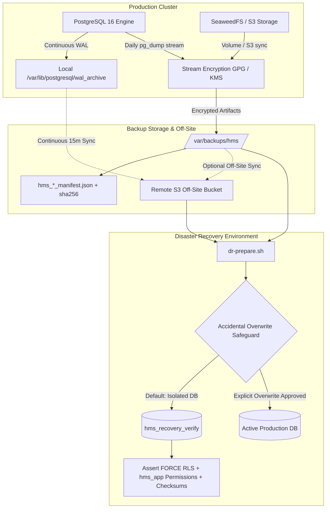

# HMS Disaster Recovery Runbook & Incident Response Plan

## 1. Executive Summary & Recovery Targets

This runbook establishes operational procedures, technical commands, and safety safeguards for disaster recovery (DR) of the Hostel Management System (HMS).

### Recovery Target Metrics

| Metric | Target | Architectural Implementation | Verification Status |
|---|---|---|---|
| **Recovery Point Objective (RPO)** | **15 minutes** | PostgreSQL continuous WAL archiving (`archive_timeout = 900s`) + frequent S3 object storage sync | **Architectural target only** — *requires recovery drill measurement* |
| **Recovery Time Objective (RTO)** | **4 hours** | Automated decryption pipelines, direct streaming restore (`restore.sh`), isolated staging environments (`dr-prepare.sh`), scripted verification | **Architectural target only** — *requires recovery drill measurement* |

> [!WARNING]
> **RPO/RTO Certification Constraint:** Do NOT claim that RPO (15m) or RTO (4h) has been achieved until an authorized, measured disaster recovery drill has been performed and timed in a certified staging environment.

---

## 2. Policy Decisions & Governance Register

The following operational policies require explicit owner sign-off prior to production deployment. In accordance with policy rules (G-09 / OD-06), safe temporary defaults are configured, and automatic deletion is disabled while set to `PENDING_OWNER_DECISION`.

| Area | Current Configuration | Pending Owner Decisions | Safe Operational Behavior |
|---|---|---|---|
| **Backup Retention** | `BACKUP_RETENTION_DAYS=PENDING_OWNER_DECISION` | 30 days vs 90 days vs 7 years (tax/financial compliance) | **No backups are deleted**; `backup.sh` bypasses pruning with an audit notice. |
| **Backup Schedule** | `BACKUP_SCHEDULE_CRON=PENDING_OWNER_DECISION` | Daily 02:00 UTC vs Twice Daily (02:00 & 14:00 UTC) | Manual execution or operator crontab configuration via `infrastructure/config/backup.cron`. |
| **Encryption Key Custody** | `BACKUP_ENCRYPTION_MODE=gpg` | GPG private key escrow vs AWS KMS key policy & IAM custody | Fail-closed: production refuses to run unencrypted backups if keys are missing. |
| **Off-site Destination** | `BACKUP_OFFSITE_ENABLED=false` | AWS S3 vs Cloudflare R2 vs Dedicated Off-site MinIO | Local encrypted backups retained; off-site sync enabled once destination bucket is approved. |

---

## 3. Disaster Recovery Architecture & Invariants



### Invariants Preserved During Recovery:
1. **PostgreSQL 16 Compatibility:** Preserves PostgreSQL 16 relational features, UUID generation, enums, constraints, and schema definitions.
2. **Prisma Schema Fidelity:** Complete table structure, migration history, and foreign keys remain identical to source migrations.
3. **FORCE ROW LEVEL SECURITY (RLS):** All tenant tables (`tenants`, `branches`, `residents`, `admissions`, `invoices`, `payments`, `complaints`, etc.) have `relrowsecurity = true` and `relforcerowsecurity = true`.
4. **`hms_app` Privilege Boundary:** The application runtime role `hms_app` is strictly `NOSUPERUSER` and `NOBYPASSRLS`. No elevated privileges on platform admin or audit logs.
5. **Tenant Isolation:** Multi-tenant boundaries and object keys (`payment-proofs/{tenantId}/{paymentId}`, `documents/{tenantId}/...`) remain strictly isolated.

---

## 4. Production Accidental Overwrite Safeguards

To prevent catastrophic operator error or automated scripts accidentally wiping production data:

1. **Default to Isolated Recovery Database:**
   The restore script (`restore.sh`) defaults to a fresh timestamped recovery database (`hms_recovery_<timestamp>`), never touching the active production database unless explicitly targeted.
2. **Two-Factor Overwrite Guard:**
   Restoring directly into an active production database (`hms_prod` or any database name containing `prod`) is blocked unless **BOTH** conditions are met:
   - CLI flag `--confirm-overwrite` is passed.
   - Environment variable `ALLOW_PRODUCTION_OVERWRITE=CONFIRM_DESTRUCTIVE_OVERWRITE` is exported.
3. **Integrity Validation First:**
   Before any database command is executed, all backup artifacts are checked against SHA-256 checksums in the manifest. If any file has been modified or corrupted, restoration halts immediately.
4. **Dry-Run Mode (`--dry-run`):**
   Operators can verify manifest parsing, checksums, and decryption pipelines without issuing any write operations to PostgreSQL or object storage.

---

## 5. Recovery Scenarios & Action Runbooks

### Scenario A: Complete Host / Hardware Loss (Bare-Metal Rebuild)

**Objective:** Provision a new host and restore database and object storage within the 4-hour RTO.

1. **Provision Host & Base Environment:**
   - Linux host (Ubuntu 22.04 LTS or Debian 12 recommended).
   - Install Docker Engine 24+ and Docker Compose v2.
   - Install core tools: `gpg`, `sha256sum`, `gzip`, `tar`, `openssl`, `aws-cli`.
2. **Clone Repository & Configure Environment:**
   ```bash
   git clone <repository_url> /opt/hms
   cd /opt/hms
   cp .env.example .env
   # Populate secrets: POSTGRES_PASSWORD, HMS_APP_PASSWORD, REDIS_PASSWORD,
   # JWT_SECRET, PLATFORM_JWT_SECRET, FIELD_ENCRYPTION_KEY, OBJECT_STORAGE_SECRET_KEY
   ```
3. **Retrieve Encrypted Backups:**
   ```bash
   mkdir -p /var/backups/hms
   # If using off-site S3:
   aws s3 sync s3://<BACKUP_OFFSITE_S3_BUCKET>/backups/hms/<BACKUP_ID>/ /var/backups/hms/
   ```
4. **Import Decryption Keys:**
   ```bash
   # If GPG asymmetric:
   gpg --import /secure/keys/hms-backup-private.asc
   # If GPG symmetric:
   export BACKUP_GPG_PASSPHRASE="<secure-passphrase>"
   ```
5. **Execute Recovery Preparation & Preflight:**
   ```bash
   ./infrastructure/scripts/dr-prepare.sh /var/backups/hms/<BACKUP_ID>_manifest.json
   ```
6. **Start Infrastructure Services:**
   ```bash
   docker compose up -d postgres redis object-storage
   ./infrastructure/scripts/health-check.sh
   ```
7. **Execute Restoration into Target Database:**
   ```bash
   export ALLOW_PRODUCTION_OVERWRITE=CONFIRM_DESTRUCTIVE_OVERWRITE
   ./infrastructure/scripts/restore.sh \
     --manifest /var/backups/hms/<BACKUP_ID>_manifest.json \
     --target-db hms_prod \
     --confirm-overwrite
   ```
8. **Start Application Services:**
   ```bash
   docker compose up -d api frontend worker nginx
   ./infrastructure/scripts/health-check.sh
   ```

---

### Scenario B: Point-in-Time Recovery (PITR) to a Specific Minute

**Objective:** Recover from an accidental batch deletion, data corruption, or malicious incident that occurred at a known timestamp (e.g. `2026-11-17 14:32:00 UTC`), minimizing data loss to <= 15 minutes.

1. **Stop Application Writes:**
   ```bash
   docker compose stop api worker
   ```
2. **Identify Target PITR Timestamp:**
   Set the exact recovery target time immediately preceding the incident:
   `TARGET_TIME="2026-11-17 14:30:00 UTC"`
3. **Prepare Staging Database Cluster:**
   - Stop PostgreSQL container:
     ```bash
     docker compose stop postgres
     ```
   - Move corrupted PGDATA to a safety directory:
     ```bash
     mv /var/lib/docker/volumes/hms_postgres_data/_data /var/lib/docker/volumes/hms_postgres_data/_data_corrupted_backup
     mkdir -p /var/lib/docker/volumes/hms_postgres_data/_data
     chmod 700 /var/lib/docker/volumes/hms_postgres_data/_data
     ```
4. **Restore Physical Base Backup:**
   ```bash
   # Extract the physical base backup corresponding to the baseline
   gpg --batch --yes --decrypt /var/backups/hms/<BASELINE_BACKUP>_postgres_physical.tar.gz.enc \
     | tar -xzf - -C /var/lib/docker/volumes/hms_postgres_data/_data
   ```
5. **Configure PITR Signals in PGDATA:**
   - Create `recovery.signal`:
     ```bash
     touch /var/lib/docker/volumes/hms_postgres_data/_data/recovery.signal
     ```
   - Append recovery parameters to `postgresql.conf`:
     ```ini
     restore_command = '/usr/local/bin/restore-wal.sh %f %p'
     recovery_target_time = '2026-11-17 14:30:00 UTC'
     recovery_target_action = 'promote'
     ```
6. **Start PostgreSQL & Monitor Replay:**
   ```bash
   docker compose up -d postgres
   docker compose logs -f postgres
   ```
   PostgreSQL will replay archived WAL segments up to `14:30:00 UTC`, remove `recovery.signal`, promote to primary, and begin accepting connections.
7. **Verify Invariants & Restart Application:**
   ```bash
   ./infrastructure/scripts/health-check.sh
   docker compose up -d api worker frontend
   ```

---

### Scenario C: Multi-Tenant Data Leakage or Single Tenant Recovery

**Objective:** Extract and restore a single tenant's data (e.g., after an isolated accidental tenant deletion) without rolling back other tenants or disrupting ongoing operations.

1. **Restore Full Backup into an Isolated Staging Database:**
   ```bash
   ./infrastructure/scripts/restore.sh \
     --manifest /var/backups/hms/<BACKUP_ID>_manifest.json \
     --target-db hms_staging_tenant_extract
   ```
2. **Export Target Tenant Records via SQL:**
   ```bash
   TENANT_ID="<target-tenant-uuid>"
   docker compose exec -T postgres pg_dump -U "$POSTGRES_USER" -d hms_staging_tenant_extract \
     --table=tenants --table=branches --table=residents --table=invoices --table=payments \
     --data-only > /tmp/tenant_${TENANT_ID}_data.sql
   ```
3. **Inspect & Apply Tenant Data to Active Database under strict RLS context:**
   Execute target insert queries setting session variable `set_config('hms.current_tenant_id', '$TENANT_ID', false)`.
4. **Restore Tenant Object Storage Assets:**
   Sync only the target tenant's prefix:
   ```bash
   aws s3 sync /tmp/storage/payment-proofs/${TENANT_ID}/ s3://private-proofs/payment-proofs/${TENANT_ID}/ --endpoint-url $OBJECT_STORAGE_URL
   ```
5. **Drop Staging Database:**
   ```bash
   docker compose exec -T postgres psql -U "$POSTGRES_USER" -d postgres -c "DROP DATABASE hms_staging_tenant_extract;"
   ```

---

## 6. Post-Restoration Verification Checklist

Following any restoration, complete the following verification steps before returning the system to live production service:

- [ ] **Database Connectivity:** `pg_isready` reports healthy.
- [ ] **Role Permissions:** `hms_app` role verified as `NOSUPERUSER` and `NOBYPASSRLS`.
- [ ] **Privilege Boundaries:** `hms_app` confirmed to have NO `DELETE` on `tenants` and NO `UPDATE`/`DELETE` on `audit_logs`.
- [ ] **Row Level Security:** Every tenant table confirmed to have `FORCE ROW LEVEL SECURITY`.
- [ ] **Schema & Migrations:** `_prisma_migrations` count and checksums match expected production state.
- [ ] **Object Storage Keys:** Payment proofs accessible at `payment-proofs/{tenantId}/{paymentId}`.
- [ ] **Application Health:** `GET /api/health/ready` returns HTTP 200 with all dependencies healthy.
- [ ] **End-to-End Auth Test:** Multi-tenant login and branch isolation confirmed.
